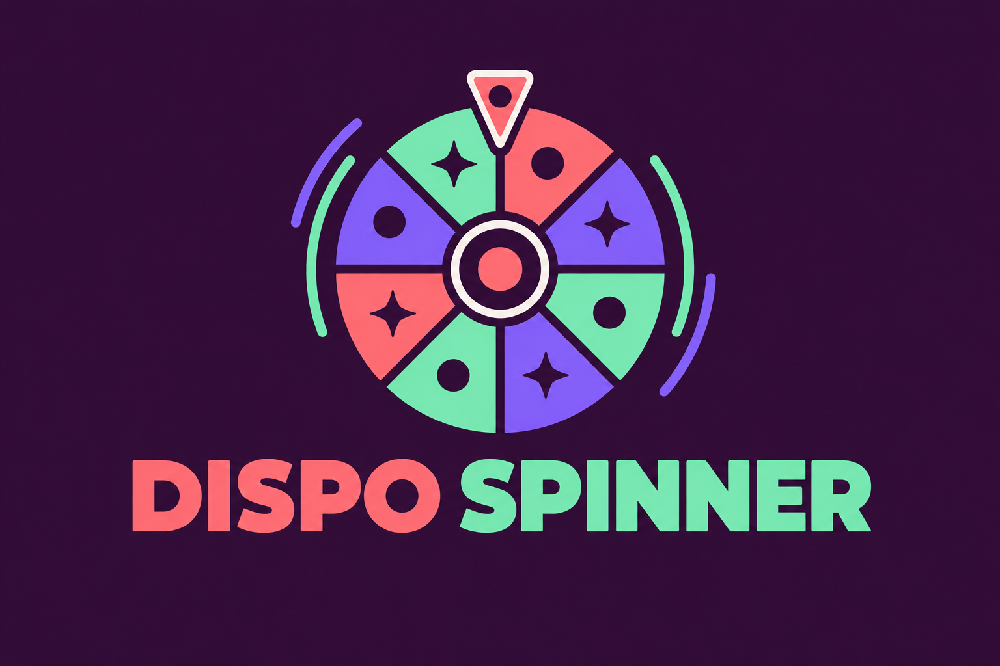

# Dispo Spinner



**A small, customizable wheel-spinner demo built with Next.js.**

[MIT license](LICENSE) · [Contributing](CONTRIBUTING.md) · [Report a bug](https://github.com/TrustlessMike/dispo-spinner/issues)

Spin an animated wheel and reveal a randomly selected label. The included labels
use a dispensary menu theme; replace them to adapt the component to another
setting. This is a browser demo, with no checkout, customer database or prize
fulfilment backend.

## Run locally

Use Node.js 22 LTS or newer and npm.

```sh
git clone https://github.com/TrustlessMike/dispo-spinner.git
cd dispo-spinner
npm ci
npm run dev
```

Open http://localhost:3000. The project uses Next.js 16 and React 19.

## Customize

The implementation is in `src/components/DispoWheel.tsx`:

- Change `DEFAULT_SEGMENTS` to replace the labels, or pass a `segments` prop.
- Change `PALETTE` to adjust the wheel colors.
- Adjust the surrounding page in `src/app/page.tsx`.

Each label has an equal chance: the demo uses `Math.random()`. There is no
weighted-prize configuration or server-side verification. Use at least two
labels. This is a discovery/demo interface, not a secure prize-drawing system.

## Build and contribute

```sh
npm run lint
npm run build
```

The existing configuration exports a static site to `out/`. The repository
also includes a Cloudflare Pages workflow that requires the owner's deployment
configuration. Forks should configure their own hosting before enabling it.

Accessibility, clearer long labels and small component improvements are useful
contributions. See [CONTRIBUTING.md](CONTRIBUTING.md).

## License

[MIT](LICENSE). Third-party dependencies retain their own licenses.
